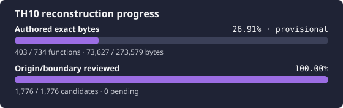

# 東方風神録 ～ Mountain of Faith

<p align="center">
  
</p>

<p align="center">
  
</p>

This project reconstructs the original Japanese TH10 version 1.00a executable.
It tracks target identity, candidate boundaries, origin, source presence,
codegen exactness, native-product closure, runtime semantics, and portability as
separate facts.

## Exact target

Supply your own legal copy at the ignored path `resources/th10.exe`.

| Property | Required value |
| --- | --- |
| Version | original Japanese 1.00a |
| Size | `487,936` bytes |
| SHA-256 | `2f14760b6fbbf57549541583283badb9a19a4222b90f0a146d5aa17f01dc9040` |
| MD5 | `7dc488d82c81dd4aee4ba098b8804d83` |
| Image base | `0x00400000` |
| Entry point | `0x004537DC` |

The pinned [thcrap version database](https://github.com/thpatch/thcrap-tsa/blob/f08b582ce57bce800955dd371fc9a68dbad5b324/base_tsa/versions.js)
classifies this exact SHA-256 as `th10`, `v1.00a`, `(original)`; patched
and Steam executables have different digests.

```bash
scripts/repo-python scripts/verify-target.py
scripts/repo-python scripts/validate-tracking.py --require-target
scripts/repo-python scripts/report-reconstruction-status.py
```

Original executables, game data, Ghidra projects, decompiler output, and
downloaded tools are private and never committed.

## Current status

Start with [the current handoff](docs/RE_HANDOFF.md), the selected owner's source
and ledger rows. [PROGRESS.md](docs/PROGRESS.md) is generated from the ledgers
and is the count authority. The inventory and origin classifications remain
provisional; the Windows i386 product, runtime semantics and portability are open.

The latest complete Hint frame owner is571 bytes/all17 fields exact. Its
[proof](docs/evidence/hint-frame-exact-20261031/README.md) preserves the real
callback and the still-nonexact consumption callee. The handoff lists remaining
frontiers without treating old matching sizes as exactness.

Use `scripts/repo-python`; it enforces the locked Capstone package. Verify the
private target before target work. Check toolchain declarations and run the
execution smoke on setup, toolchain changes or a compiler/Wine problem.
The pinned VC7.1 SP1 candidate reports compiler/linker build6030. Original
production partitions, flags, libraries, resources and link order remain open.

```bash
scripts/repo-python scripts/verify-target.py
scripts/repo-python scripts/verify-toolchain.py --check
scripts/repo-python scripts/ci.py
```

Default CI runs seven lightweight repository checks. Regenerate progress with
`scripts/repo-python scripts/progress.py` when ledger inputs change. Historical
host fixtures, failure/lifecycle simulations, sanitizer sweeps and mutation
reports are not current gates. Comparator self-tests are selected explicitly
with `ci.py --only 'STAGE'` when the affected mechanism changes.

Exact work compares complete native owners, every relocation/resolved field,
fixed local destinations, actual ABI and required callee bindings. Select only
new/affected exact owners, for example:

```bash
scripts/repo-python scripts/replay-exact-units.py \
  --unit hint-frame-update --unit hint-update-callback --json
```

Selected units with the same complete recipe share one cold artifact. Source
or header sharing alone does not require replaying every consumer. Omitting
selectors rebuilds the historical cohort and is inappropriate for ordinary
bounded work. Matching size or a structural candidate grants no exact credit.

Linked-PE acceptance binds the complete PDB contribution, PE/map/PDB identities
and exhaustive field manifest to the original target. Its incomplete harness
is not a runnable reconstructed product. See [ORACLES.md](docs/ORACLES.md),
[RE_WORKFLOW.md](docs/RE_WORKFLOW.md) and [TOOLS.md](docs/TOOLS.md).

Private caches and archives are documented in [RE_ARTIFACTS.md](docs/RE_ARTIFACTS.md).
Old paths may be archived, and source/header pin equality alone does not prove
a reusable graph or a current native comparison. Use the listed inventory for
selective restoration and recheck profiles, source order, objects and image.

## Required phase order

1. Reconcile authored boundaries and recover exact historical-toolchain units.
2. Close and exercise the faithful Windows i386 product, including data owners,
   initializers, resources, libraries, and runtime scenarios.
3. Perform semantic reconstruction using both the original target and the
   reconstructed native i386 product as runtime Oracles.
4. Start portability only after the native semantic baseline is trustworthy.

## Project map

- [`AGENTS.md`](AGENTS.md) — mandatory session and evidence rules.
- [`config/target.toml`](config/target.toml) — target and observed PE facts.
- [`config/build.toml`](config/build.toml) — explicit open whole-build graph.
- [`config/tools.lock.toml`](config/tools.lock.toml) — compiler, linker,
  frontend, optimizer, resource-tool, linked-code decoder, and headless-Wine
  lock.
- [`docs/RE_WORKFLOW.md`](docs/RE_WORKFLOW.md) — reconstruction loop and gates.
- [`docs/ORACLES.md`](docs/ORACLES.md) — claim-specific falsification rules.
- [`docs/RE_HANDOFF.md`](docs/RE_HANDOFF.md) — current resume brief, unresolved owners, and source-epoch checks.
- [`docs/RE_ARTIFACTS.md`](docs/RE_ARTIFACTS.md) — expanded private inputs, archived experiments, and selective restoration.
- [`docs/KNOWLEDGE_BASE.md`](docs/KNOWLEDGE_BASE.md) — TH10-only knowledge.

## License

Repository-authored code and documentation are provided under the MIT License.
This does not grant rights to the original game or its assets.
